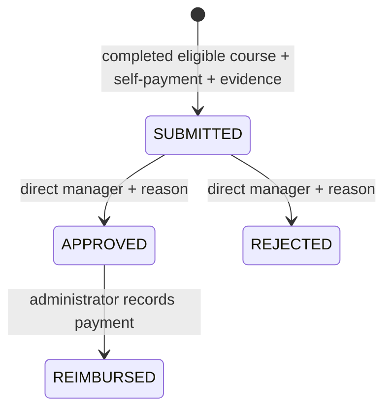

# Optional implementation guide

## Packages

| Package | Additions to the core |
|---|---|
| `model` | CategorySettings, TrainingProvider, Course, FeeClaim, ClaimAttachment, TrainingLedger, LedgerEntry, EmailNotification |
| `model.enums` | ClaimStatus, LedgerEntryKind, EmailStatus |
| `repository` | JPA repository for each added entity; only CourseRepository is exported through Spring Data REST |
| `service` | AdministrationService, ClaimService, LedgerService, ReportService, PagedApplicationService, NotificationService, EmailDispatcher |
| `controller` | AdminController, ClaimController, ReportController, CalendarController, ApplicationRestController, RestClientController |
| `config` | SecurityConfig, RestRepositoryConfig, SchedulingConfig, OptionalDemoData |
| `exception` | ApiExceptionHandler; MVC handlers for business, missing records, conflicts and malformed inputs |
| `templates` | Administration, claims, ledger, reports, monthly calendar, REST client and shared pagination |
| `static/js` | REST client using browser fetch and CSRF headers |

The core User, CourseApplication, AnnualEntitlement and PublicHoliday remain. User gains email and enabled status. CourseApplication optionally references a catalogue Course while keeping its submitted title/provider/category/fee snapshot.

## REST contracts

Session authentication is shared with the web interface. Log in first. For POST requests send the rendered page's CSRF token as `X-CSRF-TOKEN` and retain its session cookie.

- `GET /api/applications?page=0&size=10`: current user's current-year history. Response fields: content, number, size, totalElements, totalPages, first, last. Content summaries contain id, title, category, startDate, endDate, fee and status.
- `GET /api/applications/{id}`: owned application summary; another user's ID returns 404.
- `POST /api/applications`: validated ApplicationForm JSON; returns 201 + Location. Uses the same transactional service as the MVC form.
- `GET /data/courses`: paged HAL catalogue supplied by Spring Data REST. Course writes are disabled; administrators maintain courses through validated administration services.
- User, attachment, claim, ledger and notification repositories are not exported.

Example POST body:

```json
{
  "courseTitle": "Spring fundamentals",
  "trainingProvider": "Training Academy",
  "category": "EXTERNAL_COURSE",
  "startDate": "2027-02-08",
  "endDate": "2027-02-08",
  "startSession": "AM",
  "endSession": "PM",
  "courseFee": 250,
  "justification": "Improve application design"
}
```

Choose future working dates and configure entitlements for their year. The browser client demonstrates both endpoint families without extra frontend dependencies.

## Claims and accounting



Employee row locks serialize claim decisions and reimbursements. A unique application constraint prevents duplicate claims; event keys prevent duplicate ledger events. Attachments are stored in the database and are available only to the employee, their current direct manager, or an administrator.

Ledger entries distinguish budget adjustments, approved fees, released fees and reimbursements. Do not sum all entry kinds as a balance: reimbursement is a payment record against a fee already committed. The ledger page presents current allowance usage alongside the event history.

## Administration choices

The brief's employee delete operation is implemented as account deactivation to retain course, claim and ledger history. Course/provider removal uses the active flag. Category enum codes keep the mandatory business rules stable; their labels and availability are editable.

Annual entitlement changes are explicit administrator adjustments. They may lower the limit below existing usage, yielding negative remaining allowance; existing approved records remain, while subsequent submissions/approvals must fit the new allowance. Holiday changes affecting booked courses are blocked to keep computed day usage consistent.

## Security boundaries

Spring Security checks the session's current account and roles on each request, so deactivation and role removal take effect on existing sessions. Login renews the session. CSRF protection covers login and all state changes, including multipart and REST requests. Domain services independently enforce ownership and reporting relationships.

The standalone REST catalogue is intentionally read-only. Full entities containing passwords and file bytes are not serialized by application endpoints. CSV cells beginning with formula characters are prefixed before export. Templates and the JavaScript client render user text without interpreting it as HTML.

## Comparison with the core

```sh
git diff b62d1c18eec1d67116413e0696dac43f29af1592 HEAD --stat
git diff b62d1c18eec1d67116413e0696dac43f29af1592 HEAD -- src/main/java
```

The imported baseline remains in this repository's history, making the optional additions reviewable as a diff. No course PDFs are included.
